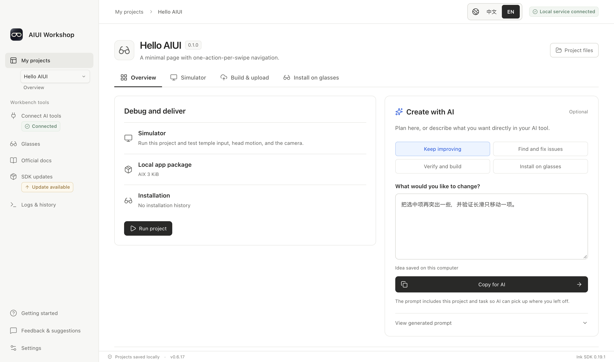
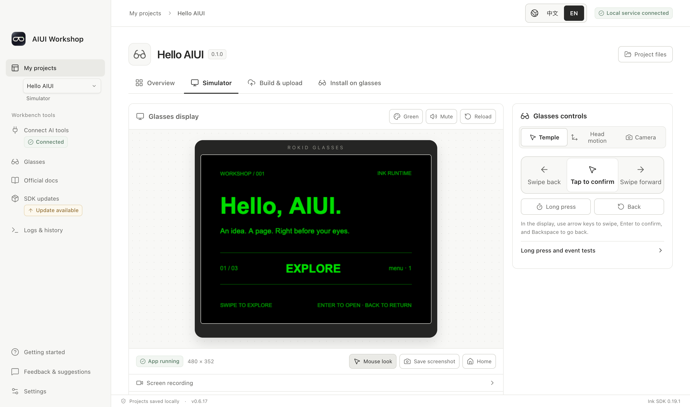

# AIUI Workshop

[Download the latest release](https://github.com/syjstc/aiui-workbench/releases/latest) · [Illustrated guide (Chinese)](docs/getting-started.md) · [中文](README.md)

A local workbench for Rokid AIUI. Start a project, build it with your AI coding tool, test it on your computer, then package and install it on the glasses.



## Download and install

Download signed macOS and portable Windows packages from [GitHub Releases](https://github.com/syjstc/aiui-workbench/releases/latest). The release includes `SHA256SUMS.txt`. CNB offers fixed download links. [Changelog (Chinese)](CHANGELOG.md)

| Platform | CNB download | Install |
| --- | --- | --- |
| macOS · Apple Silicon | [Download DMG](https://cnb.cool/openwork-labs/aiui-workbench/-/releases/download/stable/AIUI-Workbench-latest-darwin-arm64.dmg) | Drag `AIUI Workshop.app` to Applications. The app is Developer ID signed and Apple notarized. |
| Windows 10 / 11 · x64 | [Download ZIP](https://cnb.cool/openwork-labs/aiui-workbench/-/releases/download/stable/AIUI-Workbench-latest-win32-x64.zip) | Extract the entire archive and run `AIUI Workshop.exe`. The portable app is unsigned. Check the source and SHA256 before running it. |

The desktop app includes Ink, npm, the AIX CLI, ADB, and scrcpy. macOS can download and restart from within Workshop. On Windows, download the new version and replace the portable app directory.

## Start a project

1. Create a project from **My projects**, or import the [Hello AIUI example](examples/hello-aiui).
2. To build with AI, open **Connect AI tools**, copy the setup request, and paste it into your usual AI coding tool. Workshop confirms the connection when the AI successfully reads its development context.
3. Open the project’s **Simulator** tab, run your app, and try temple and head inputs while watching its logs.
4. In **Build & upload**, check the code and generate an AIX. Once debugging is enabled on your glasses, choose the device under **Install on glasses**.

## Key features

- **Project workspace.** Overview, simulator, build, cloud upload, and glasses installation follow the current project. Workshop returns to the same project tab after a visit to another tool. Use the sidebar picker to switch projects or go back to the library.
- **Real Ink simulator.** Run your `.ink` pages and test temple taps, holds, and swipes. Switch between color and monochrome, and use a local photo or webcam for camera input. Explore head orientation and live IMU readings, enter your own values, or replay an IMU trace.
- **AI tools and skills.** MCP lets AI edit the same source files, verify interactions, capture evidence, build packages, and resume installation. **Connect AI tools → Skill library** exposes the built-in Workshop skill, official Rokid skills, and their references. Load specialist guidance as needed. [AI workflow and recovery (Chinese)](docs/automated-development.md)
- **Build and install.** Check SDK compatibility and see the built AIX size. Connect glasses over USB or Wi-Fi, manage apps and files, inspect logs, and mirror the display. [Wireless setup guide (Chinese)](docs/wireless-debugging.md)
- **Cloud drafts and review.** Open **Upload and review** to check Rokid sign-in and follow three steps for uploading a draft, preparing materials, and reviewing the submission. Browse read-only cloud versions under **Official apps**. Final submission requires your confirmation in the desktop app. [Draft and review guide](docs/platform-uploads.en.md)



Browse and search the offline official documentation, or check and switch SDK versions per project. **Feedback & suggestions** previews the sanitized report before it is sent. [Documentation library (Chinese)](docs/document-library.md) · [Feedback guide (Chinese)](docs/feedback.md)

These screenshots use the public examples in an isolated profile. Simulator checks, device installation, worn testing, and store review are separate milestones.

## Run from source

Use Node.js **24 LTS** or later. The minimum supported version is **22.22**.

```sh
git clone https://github.com/syjstc/aiui-workbench.git
cd aiui-workbench
npm ci
npm run prepare:tools
npm run dev
```

`prepare:tools` downloads and verifies ADB and scrcpy. You can skip it for project, simulator, and documentation work. Use `npm run web` to open the local Web interface.

For manual MCP setup, open the advanced settings in **Connect AI tools**. Use `aiui_context_get({setup:true})` before `aiui_workflow_start`, then use `aiui_workflow_continue` to verify, build, and resume installation after editing the project. [MCP and CLI reference (Chinese)](docs/ai-tool-workflows.md)

## Documentation and licensing

- [Illustrated guide (Chinese)](docs/getting-started.md) · [Public examples](examples/)
- [Web and update sources (Chinese)](docs/web-and-updates.md) · [Project removal (Chinese)](docs/project-removal.md)
- [Development and validation (Chinese)](docs/development.md) · [Sign and release (Chinese)](docs/releasing.md) · [Contributing](CONTRIBUTING.md)

Projects, tasks, and the official desktop session are stored locally. Workshop is an independent community project. Project code and examples use the [MIT license](LICENSE). Upstream documentation, Ink, and other dependencies retain their original licenses. [Third-party notices](NOTICE.md)
