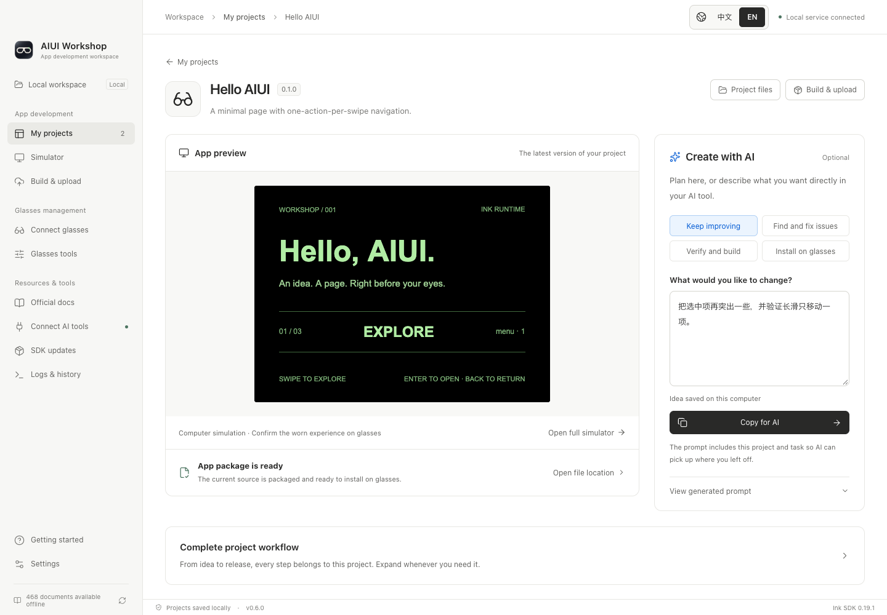

# AIUI Workshop

[中文](README.md) · [Download](https://github.com/syjstc/aiui-workbench/releases/latest) · [Draft uploads and review](docs/platform-uploads.en.md) · [AI / MCP workflows](docs/ai-tool-workflows.md)

A local workbench for Rokid AIUI development. Manage projects, read official documentation offline, run the real Ink runtime, build AIX packages, upload cloud drafts and submit them for review after user confirmation. Connect your AI coding tools through MCP. Available as a desktop app and a local Web interface.

**Independent community project; not affiliated with or endorsed by Rokid.** Upstream runtimes, documentation and tools retain their original licenses.


## Download

Current version: **0.6.0**. Download packages and `SHA256SUMS.txt` from [GitHub Releases](https://github.com/syjstc/aiui-workbench/releases/tag/v0.6.0).

| Platform | Install | Signing |
| --- | --- | --- |
| macOS, Apple Silicon | Open the `darwin-arm64.dmg` and drag `AIUI Workshop.app` to Applications; ZIP is also available | Developer ID; see release notes for notarization verification |
| Windows 10 / 11, x64 | Extract the entire `win32-x64.zip`, launch `AIUI Workshop.exe` | Unsigned |

The app includes Electron/Node, npm, official CLI, Ink WASM, documentation, ADB and scrcpy. No separate Node.js, Android Studio or PATH setup is needed. Windows may show a reputation warning for the unsigned app; verify the source and checksum before running it. Intel Mac, Windows ARM64 and Linux release downloads are not currently provided.

## Build with AI

Copy one instruction from **Connect AI tools** into your usual AI client. The AI configures MCP, checks the official development skill and environment, then works on your idea. Each project has a live preview, optional idea input and presets for refining, fixing, validating or installing the app. The shared workflow prepares a project, edits its real source, validates behavior and builds an AIX package; installation can continue when glasses are ready. Recovery steps keep the same project and task. See [the complete workflow](docs/automated-development.md).



## Features

The maintainer has no physical Windows machine and has not completed full Windows hardware acceptance. Automated checks do not guarantee that every Windows environment will run perfectly. Testing and issue reports are welcome.

- **Project removal:** two-stage confirmation with the full project name and path. Unbinding preserves local files; deletion moves the entire project folder to the system Trash/Recycle Bin. See [the illustrated guide](docs/project-removal.md).
- **Shared projects:** import an AIUI directory or create a Page. External source changes refresh the preview automatically.
- **Official runtime:** run real `.ink` source, replay temple keys and repeated swipe events, inject orientation with the mouse, 3D head model, sliders or motion loops. Use local photos or an explicitly enabled computer camera.
- **Offline knowledge:** 468 official documents, 81 diagrams and the public `aiui-dev` skill, with the official navigation hierarchy, full-corpus text/code search, automatic daily updates and expandable offline images. Long articles load automatically. Prepare SDK/CLI upgrades, check compatibility and migrate projects individually.
- **AI integration:** MCP and the Workshop CLI share previews, assertions, screenshots, silent recordings, build results and logs with desktop/Web.
- **Shared diagnostics:** AI tool responses include unread problems for the current project and shared environment, with project names, paths and recovery steps. Read history remains available; marking a problem read does not mark it fixed.
- **Persistent simulator storage:** project-isolated `wx` storage survives preview and app restarts. Computer and glasses data are stored separately.
- **Official platform drafts and review:** AI prepares materials and calls MCP; Workshop uploads AIX packages, verifies cloud digests and saves review drafts. Submission requires the user's native desktop confirmation. Reuse an OS-encrypted official session after signing in, with an explicit sign-out action.
- **Read-only cloud catalog:** separate Build & upload and Official apps tabs. One official Agent ID binding drives build, upload and review; show and copy the full ID. Inspect official icons, descriptions, permissions, images, videos and draft/review/published versions. Neither Workshop nor MCP provides cloud deletion.
- **Glasses tools:** device information, files, real APK names/icons, screenshots, logs, and embedded mirroring with an optional separate window that closes when mirroring ends.
- **Read-only AIUI catalogs:** separate development, store, and system-provided apps. Store and system-provided apps have no delete, uninstall, or clear-data controls. Restricted store inventories are reported as unavailable, with an unknown count.
- **Update notice:** a persistent bottom-left notice offers download and restart on macOS. Windows offers package download and manual installation.
- **Language and appearance:** persistent 中文 / EN buttons, light/dark/system themes.

All documentation screenshots use only this repository's public examples in a fresh profile. They show simulation, not optical capture.

## Quick start

1. A fresh workspace opens **Connect AI tools**. Optionally enter your idea, click **Copy for AI** and paste into your AI client. Workshop confirms the connection after the AI successfully reads its context.
2. Describe an app. It appears in **My projects**; you can also import [`examples/hello-aiui`](examples/hello-aiui) or create a Page project.
3. Open the project to see its live preview and continue with an idea or a preset instruction. Select **Open full simulator** for orientation, camera and repeated swipe controls.
4. Ask AI to validate and build. Follow **Getting started → Install on glasses** when ready to connect through a supported USB or wireless ADB setup, then continue the same task.

[`examples/motion-lab`](examples/motion-lab) demonstrates orientation sensors and lifecycle cleanup. The [illustrated guide](docs/getting-started.md) has more details.

## Upload drafts and submit for review

**The official platform integration is experimental.** Studio endpoints may change. Verify official results after uploading or submitting; do not repeat an operation with an uncertain result. Real-account draft upload and digest verification have been checked; real review submission and store availability remain unverified.

1. Sign in once through the desktop app's **Build & upload → Sign in to Rokid**. Successful sign-in immediately synchronizes and closes the sign-in window. Valid encrypted sessions are reused. Keep the desktop app running when using Web, CLI or MCP.
2. In **Build & upload**, select one local app and set its official binding after checking its formal name and full official Agent ID. Build, upload and review share this target. Create a new official identity on the website first when needed.
3. Check/build the AIX and upload a cloud draft. Workshop reports success only after verifying the target, version and digest. Local and cloud versions are tracked separately.
4. Let AI upload the icon, preview images/video and text through MCP, save review materials and request your confirmation. Saving materials does not submit a review.
5. Check the draft on desktop and confirm submission in the native dialog. **The version and materials must be ready for public release: store availability after approval follows official rules, and Workshop does not guarantee a separate publication confirmation.**

**Official apps** is a read-only catalog. Delete records manually on the official website. MCP may upload new drafts, prepare materials and request confirmation; it has no submission, publishing or cloud-deletion tool. Signing out revokes authorization, clears credentials and stops platform tasks while preserving local projects and receipts.

See [the complete guide, material requirements, permissions and troubleshooting](docs/platform-uploads.en.md).

## Run from source

Use Node.js **24 LTS**, minimum 22.22:

```sh
git clone https://github.com/syjstc/aiui-workbench.git
cd aiui-workbench
npm ci
npm run prepare:tools
npm run dev
```

`prepare:tools` downloads pinned ADB/scrcpy archives and verifies SHA256. Generated binaries are excluded from Git. You can skip it for simulator/documentation-only use.

```sh
npm run web
npm run web -- --port 3100 --no-open
```

The Web interface binds to `127.0.0.1` only. The npm package is not published yet.

## MCP workflow

Copy the complete setup instruction from **Connect AI tools**; manual stdio configuration remains under advanced options. Its stable launcher uses the same local data directory. Tools and schemas are discovered from the active service.

```text
aiui_context_get({setup:true}) → aiui_workflow_start
→ edit project source → aiui_workflow_continue
```

`aiui_workflow_continue` combines explicit behavior assertions, packaging and optional installation. Resume the same workflow after following its recovery steps. MCP-only clients can read and write source with `aiui_project_files`. Individual preview and build tools remain available. Use `aiui_job_wait` only when the returned status is `running`. See [automated development](docs/automated-development.md) and [AI tool workflows](docs/ai-tool-workflows.md).

## Data and limitations

Projects, camera fixtures, platform sessions and task records stay on your computer. Default data directories are `~/Library/Application Support/AIUI Workbench` on macOS and `%APPDATA%/AIUI Workbench` on Windows; override with `AIUI_WORKBENCH_HOME`. Control endpoints require a random token and reject foreign origins. Do not share connection files or token-bearing Web startup URLs.

The bundled Ink Web SDK is **0.19.1**, its WASM engine is **0.19.0**, and the CLI is **0.12.0**. Photo fixtures, computer camera streams and frame snapshots are supported. Original glasses capture resolution/optics, audio/video capture, Bluetooth, location tracks, speech/model services and arbitrary outbound app networking are not fully simulated. No AI model is bundled.

Simulation, physical installation, worn-device acceptance and store publishing are separate. Draft upload and cloud package/source digest verification have been checked with a real account. Review submission requires the user's native desktop confirmation; building or uploading does not mean a version is published. See [platform drafts and review](docs/platform-uploads.en.md). macOS updates verify and stage a signed application, restart, and restore the previous app if replacement fails. Windows packages are installed manually.

## Development and licensing

See [development and validation](docs/development.md), [release signing/notarization](docs/releasing.md), [contributing](CONTRIBUTING.md) and [changelog](CHANGELOG.md).

Original code and examples: [MIT](LICENSE). Third-party components: [notices](NOTICE.md) and [dependency license inventory](THIRD_PARTY_LICENSES.json).
