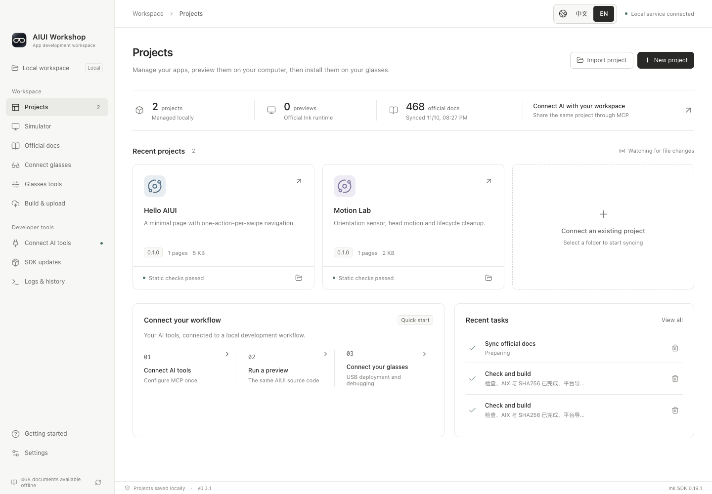

# AIUI Workshop

[中文](README.md) · [Download](https://github.com/syjstc/aiui-workbench/releases/latest) · [AI / MCP workflows](docs/ai-tool-workflows.md)

A local workbench for Rokid AIUI development. Manage projects, read official documentation offline, run the real Ink runtime, build AIX packages and connect your AI coding tools through MCP. Available as a desktop app and a local Web interface.

**Independent community project; not affiliated with or endorsed by Rokid.** Upstream runtimes, documentation and tools retain their original licenses.



## Download

Current version: **0.4.0**. Download packages and `SHA256SUMS.txt` from [GitHub Releases](https://github.com/syjstc/aiui-workbench/releases/latest).

| Platform | Install | Signing |
| --- | --- | --- |
| macOS, Apple Silicon | Open the `darwin-arm64.dmg` and drag `AIUI Workshop.app` to Applications; ZIP is also available | Developer ID; see release notes for notarization verification |
| Windows 10 / 11, x64 | Extract the entire `win32-x64.zip`, launch `AIUI Workshop.exe` | Unsigned |

The app includes Electron/Node, npm, official CLI, Ink WASM, documentation, ADB and scrcpy. No separate Node.js, Android Studio or PATH setup is needed. Windows may show a reputation warning for the unsigned app; verify the source and checksum before running it. Intel Mac, Windows ARM64 and Linux release downloads are not currently provided.

## Features

The maintainer has no physical Windows machine and has not completed full Windows hardware acceptance. Automated checks do not guarantee that every Windows environment will run perfectly. Testing and issue reports are welcome.

- **Project removal:** two-stage confirmation with the full project name and path. Unbinding preserves local files; deletion moves the entire project folder to the system Trash/Recycle Bin. See [the illustrated guide](docs/project-removal.md).
- **Shared projects:** import an AIUI directory or create a Page. External source changes refresh the preview automatically.
- **Official runtime:** run real `.ink` source, replay temple keys and repeated swipe events, inject orientation with the mouse, 3D head model, sliders or motion loops. Use local photos or an explicitly enabled computer camera.
- **Offline knowledge:** 468 official documents and the public `aiui-dev` skill, with search and verified snapshot updates. Prepare SDK/CLI upgrades, check compatibility and migrate projects individually.
- **AI integration:** MCP and the Workshop CLI share previews, assertions, screenshots, silent recordings, build results and logs with desktop/Web.
- **Glasses tools:** device information, files, real APK names/icons, screenshots, logs, and embedded mirroring with an optional separate window that closes when mirroring ends.
- **Read-only AIUI catalogs:** separate development, store, and system-provided apps. Store and system-provided apps have no delete, uninstall, or clear-data controls. Restricted store inventories are reported as unavailable, with an unknown count.
- **Update notice:** a persistent bottom-left notice offers download and restart on macOS. Windows offers package download and manual installation.
- **Language and appearance:** persistent 中文 / EN buttons, light/dark/system themes.

All documentation screenshots use only this repository's public examples in a fresh profile. They show simulation, not optical capture.

## Quick start

1. Launch Workshop and import [`examples/hello-aiui`](examples/hello-aiui), or create a Page project.
2. Click its card to preview. Arrow keys navigate, Enter confirms and Backspace returns. Open the interaction panel to send repeated swipe sequences.
3. Open **Connect AI tools** and copy the generated stdio MCP configuration into your AI tool.
4. Check and build an AIX package. For physical glasses, follow **Getting started**: use the dedicated debugging cable for your model and enable glasses ADB debugging in the Rokid AI phone app.

[`examples/motion-lab`](examples/motion-lab) demonstrates orientation sensors and lifecycle cleanup. The [illustrated guide](docs/getting-started.md) has more details.

## Run from source

Use Node.js **24 LTS**, minimum 22.22:

```sh
git clone https://github.com/syjstc/aiui-workbench.git
cd aiui-workbench
npm ci
npm run prepare:tools
npm run dev
```

`prepare:tools` downloads pinned ADB/scrcpy archives and verifies SHA256. Generated binaries are excluded from Git. You can skip it for simulator/documentation-only use.

```sh
npm run web
npm run web -- --port 3100 --no-open
```

The Web interface binds to `127.0.0.1` only. The npm package is not published yet.

## MCP workflow

Copy the generated configuration from the running app; its stable launcher uses the same local data directory. Tools and schemas are discovered from the active service.

```text
aiui_context_get → import/create project → edit local source
→ aiui_preview_test → aiui_project_build
```

`aiui_preview_test` combines replay, behavior assertions, PNG and logs. `aiui_project_build` performs official checks and creates AIX/SHA256. Use `aiui_job_wait` only when the returned status is `running`. See [AI tool workflows](docs/ai-tool-workflows.md).

## Data and limitations

Projects, camera fixtures, platform sessions and task records stay on your computer. Default data directories are `~/Library/Application Support/AIUI Workbench` on macOS and `%APPDATA%/AIUI Workbench` on Windows; override with `AIUI_WORKBENCH_HOME`. Control endpoints require a random token and reject foreign origins. Do not share connection files or token-bearing Web startup URLs.

The bundled Ink Web SDK is **0.19.1**, its WASM engine is **0.19.0**, and the CLI is **0.12.0**. Photo fixtures, computer camera streams and frame snapshots are supported. Original glasses capture resolution/optics, audio/video capture, Bluetooth, location tracks, speech/model services and arbitrary outbound app networking are not fully simulated. No AI model is bundled.

Simulation, physical installation, worn-device acceptance and store publishing are separate. Automatic platform upload/review is unverified. macOS updates verify and stage a signed application, restart, and restore the previous app if replacement fails. Windows packages are installed manually.

## Development and licensing

See [development and validation](docs/development.md), [release signing/notarization](docs/releasing.md), [contributing](CONTRIBUTING.md) and [changelog](CHANGELOG.md).

Original code and examples: [MIT](LICENSE). Third-party components: [notices](NOTICE.md) and [dependency license inventory](THIRD_PARTY_LICENSES.json).
