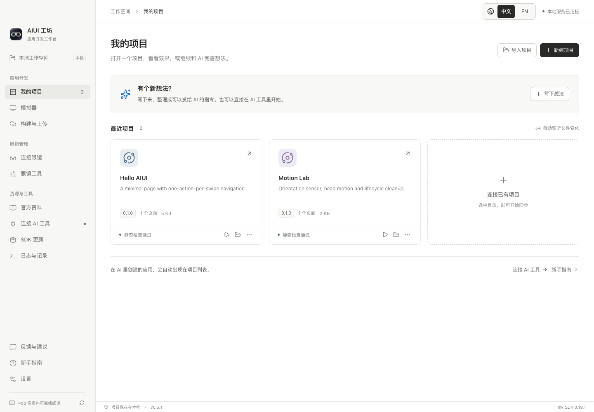
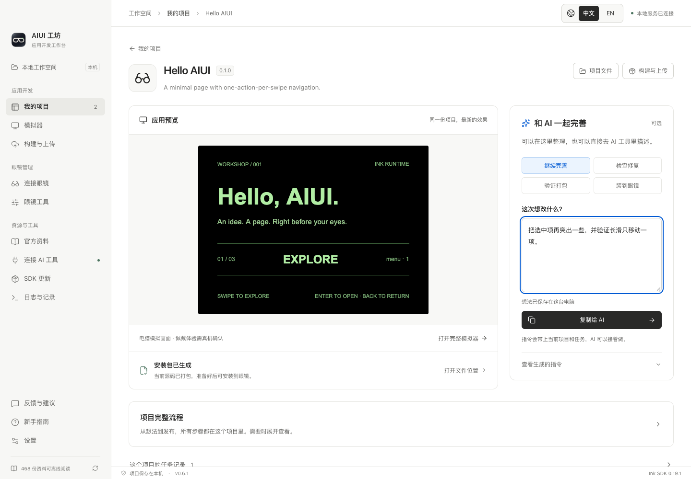
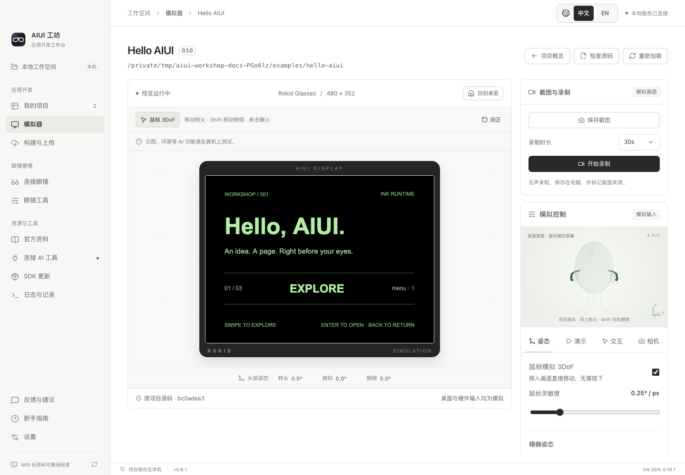

# AIUI 工坊 · AIUI Workshop

[English](README.en.md) · [下载桌面版](https://github.com/syjstc/aiui-workbench/releases/latest) · [使用指南](docs/getting-started.md) · [草稿上传与提审](docs/platform-uploads.md) · [AI / MCP 工作流](docs/ai-tool-workflows.md) · [项目经验](docs/aiui-project-lessons.md)

一个面向 Rokid AIUI 的本地开发工作台：管理项目、阅读官方资料、运行真实 Ink 模拟器、构建 AIX、上传官方平台草稿，并在用户确认后提交审核。通过 MCP 与你常用的 AI 编程工具协作，提供 macOS、Windows 桌面客户端及本地 Web 界面。

**独立社区项目，与 Rokid 官方无隶属关系。** 内置官方运行时和公开资料，第三方组件保留原有许可。



## 下载与安装

当前版本 **0.6.1**，新增内容见 [更新记录](CHANGELOG.md)。在 [GitHub Releases](https://github.com/syjstc/aiui-workbench/releases/tag/v0.6.1) 下载安装包及 `SHA256SUMS.txt`。

| 平台 | 安装方式 | 签名 |
| --- | --- | --- |
| macOS · Apple Silicon | 打开 `darwin-arm64.dmg`，将 `AIUI Workshop.app` 拖入“应用程序”；也保留 ZIP | Developer ID；公证核验结果见发行说明 |
| Windows 10 / 11 · x64 | 完整解压 `win32-x64.zip`，双击 `AIUI Workshop.exe` | 未签名 |

客户端自带运行时、npm、官方 CLI、ADB 和 scrcpy，无需安装 Node.js、Android Studio 或另配 PATH。Windows 未签名包可能显示系统信誉提示，请先核对下载来源和 SHA256。当前没有 Intel Mac、Windows ARM64 或 Linux 的正式下载包。

**维护者目前没有 Windows 实体机器，尚未完成完整的 Windows 实机体验验证。** 自动检查与结构验收不能代表每个环境都能完美运行，欢迎协助测试并反馈问题。

## AI 自动制作

在已连接工坊的 AI 工具里描述应用需求。AI 可自动准备项目、编辑源码、运行交互验证、打包，并在眼镜就绪后安装和启动。卡住时返回具体操作步骤，完成后从原任务继续；桌面以“我的项目”为入口，每个项目集中展示预览、可选的想法与 AI 指令、完整流程和记录。详见 [自动制作与故障恢复](docs/automated-development.md)。



## 可以做什么

- **反馈与建议**：工坊自身问题或功能建议可从左下角「反馈与建议」生成脱敏预览，核对后直接由统一机器人创建 issue。目标跟随已保存的更新源仓库，用户无需 GitHub 账号或验证码；相同内容去重并限制提交频率。详见 [反馈范围与部署](docs/feedback.md)。
- **解绑与删除**：项目卡片“…”菜单提供两步确认、完整名称输入与路径核对。解绑保留文件，删除移到系统废纸篓／回收站。见 [操作说明](docs/project-removal.md)。
- **项目库与实时预览**：导入 AIUI 目录或新建项目；编辑器与 AI 修改的就是同一份源码，文件变化自动刷新。
- **真实 Ink 模拟器**：运行 `.ink`，回放镜腿按键、可调时长的长按、长滑与重复事件；鼠标、头模、三轴滑条和自动动作共享姿态输入。支持本地照片和主动开启的电脑摄像头。
- **官方资料与 SDK**：内置 468 份资料、81 张配图和公开 `aiui-dev` Skill，提供官方层级目录、全库全文搜索和每日自动更新，长文自动读取、图片可离线查看和放大。见 [资料库说明](docs/document-library.md)。SDK/CLI 升级先检查项目兼容性，支持逐项目切换与回退。
- **MCP / CLI 协作**：AI 可读取规范、操作预览、执行断言、截图、录制短片及检查打包；桌面、Web、CLI 和 MCP 共享项目、日志与任务。
- **官方平台草稿与提审**：AI 准备材料并调用 MCP，工坊上传 AIX、核对云端摘要、保存提审资料；正式提审必须由用户在桌面原生窗口确认。一次登录后复用系统加密会话，支持明确退出。
- **官网应用只读列表**：“打包与上传”和“官网应用”分为两个标签页。统一绑定一个官网 Agent ID，完整显示并支持复制；查看官方图标、介绍、权限、图片、视频及草稿／审核／已上架版本。工坊和 MCP 不提供云端删除。
- **眼镜工具**：设备诊断、文件与 APK 管理、真实名称与图标、截图、日志和默认内嵌的实时投屏。小窗口可单独打开或召回，结束投屏时同步关闭。
- **AIUI 分类查看**：开发版、商店正式版与系统内置信息分开显示。正式版和内置版仅供查看，工坊不提供删除、卸载或清空数据。部分固件未开放商店清单权限，会明确显示不可读取，不会把未知数量显示成零。
- **升级提醒**：启动与回到应用时自动检查，左下角提示新版本；macOS 支持下载、校验并重启升级，Windows 提供下载和手动安装入口。更新源可修改、可恢复默认。
- **中英文与外观**：右上角随时切换中文 / EN，支持浅色、深色和跟随系统。



所有截图均在全新隔离数据目录中使用本仓库的公开示例拍摄，未展示个人业务项目。截图显示电脑模拟画面。

## 第一次使用

1. 首次打开进入“连接 AI 工具”。可填写想法，点击“复制完整连接指令”，将包含本机配置的完整内容粘贴到你常用的 AI 工具；AI 准备连接、开发指引和环境。成功读取工坊后，界面自动确认。
2. 告诉 AI 要做什么；生成的应用出现在“我的项目”。也可导入本仓库的 [`examples/hello-aiui`](examples/hello-aiui) 或新建 Page。
3. 打开项目查看实时预览，用想法框或继续完善、检查修复、验证打包等预置指令接着制作。需要姿态、相机或重复滑动控制时，点击“打开完整模拟器”。
4. 让 AI 验证、打包；准备好安装时，按“新手指南 → 装到眼镜”开启调试，用专用线或支持的无线方式连接，再继续原任务。

完整步骤见 [图文使用指南](docs/getting-started.md)。公开示例包括 [菜单与离散输入](examples/hello-aiui) 和 [姿态传感器](examples/motion-lab)。

## 上传草稿与提交审核

**官方平台对接仍为实验功能。** Studio 接口可能随平台更新失效；上传、提审后应核对官网结果，结果不明时不要重复提交。真实账号草稿上传与摘要回读已验证，真实提审及上架结果尚未完成验证。

1. 在桌面“构建与上传 → 登录官方平台”登录一次。登录成功立即同步并关闭登录窗口；后续复用尚有效的加密会话。使用 Web、CLI 或 MCP 时也需保持该桌面客户端运行。
2. 在“打包与上传”只选择一次本地应用，通过“设置官方绑定”核对正式名称和完整官网 Agent ID。构建、上传和提审共用此绑定；新应用先在官网创建身份。
3. 检查并打包 AIX，上传为云端草稿。工坊回读目标、版本和摘要后才报告上传成功；本地版本与云端版本分别保留。
4. 让 AI 通过 MCP 上传图标、预览图片／视频和文案，保存提审草稿并请求你确认。保存材料不会提交审核。
5. 在桌面核对资料，点击“核对完成，确认提交审核”，再在原生窗口确认。**确认时应确保版本与材料可公开发布；审核通过后的上架规则以官网为准，工坊不保证还有单独的发布确认步骤。**

“官网应用”仅提供只读查询和刷新，删除须本人去官网操作。MCP 仍可上传新草稿、准备材料和请求确认，但没有正式提审、发布或云端删除工具。“退出官方账号”会撤销授权、清除登录凭据并停止平台任务，本地项目与回执保留。

详见 [完整操作、材料要求、权限边界与故障处理](docs/platform-uploads.md) 和 [MCP 上传流程](docs/ai-tool-workflows.md#草稿上传与用户确认提审)。

## 从源码运行

使用 Node.js **24 LTS**（最低 22.22）：

```sh
git clone https://github.com/syjstc/aiui-workbench.git
cd aiui-workbench
npm ci
npm run prepare:tools
npm run dev
```

`prepare:tools` 从固定的上游地址下载 ADB / scrcpy，并验证 SHA256；生成的二进制不进入 Git。只使用模拟器或资料时可跳过这一步。

本地 Web 界面：

```sh
npm run web
# 固定端口，不自动打开浏览器
npm run web -- --port 3100 --no-open
```

Web 仅监听 `127.0.0.1`。npm 包暂未发布，请使用源码命令或桌面包。

## 连接 AI 工具

在“连接 AI 工具”复制完整指令，工坊会维护稳定启动入口；手动 stdio MCP 配置收在高级选项中。推荐工作流：

```text
aiui_context_get({setup:true}) → aiui_workflow_start
→ AI 编辑项目源码 → aiui_workflow_continue
```

`aiui_workflow_continue` 合并交互验证、打包和可选真机安装；卡住时读取恢复步骤，继续同一个 workflowId。源码可用 MCP 的 `aiui_project_files` 读写，诊断会随 AI 工具响应按项目附带，已读与已修复分别记录。`aiui_preview_test`、`aiui_project_build` 等单项工具继续保留。只有返回 `status: running` 时才使用 `aiui_job_wait`。详见 [自动制作与恢复](docs/automated-development.md) 和 [工具参数](docs/ai-tool-workflows.md)。

## 数据与能力边界

项目、照片、账号会话和任务记录保存在本机。默认目录：macOS `~/Library/Application Support/AIUI Workbench`；Windows `%APPDATA%/AIUI Workbench`。可通过 `AIUI_WORKBENCH_HOME` 覆盖。本地控制接口使用随机口令并拒绝跨站来源；不要分享带口令的 Web 启动链接或本地连接文件。

- 模拟器使用官方 **Ink Web SDK 0.19.1**，对应 **WASM 引擎 0.19.0**；CLI 为 **0.12.0**。
- 相机支持照片素材、电脑摄像头、连续取景和抓帧；不模拟眼镜原始分辨率、光学效果或音视频采集。
- 蓝牙、定位轨迹、语音/模型服务、应用任意外网请求尚未完整模拟。工坊不内置 AI 模型。
- 模拟验证、真机安装、佩戴体验和平台上架分别验收。草稿上传、云端包及代码摘要回读已完成真实账号验证；真实提审仍需用户在工坊确认，本地打包或上传不表示已上架。详见 [官方平台草稿与提审](docs/platform-uploads.md)。
- macOS 的应用内升级需要安装目录可写；从只读磁盘映像运行时，请用 DMG 拖入“应用程序”。Windows 自动覆盖安装尚未提供，下载后手动替换便携目录。

## 文档与开发

- [图文使用指南](docs/getting-started.md)
- [一句需求自动制作与故障恢复](docs/automated-development.md)
- [AI / MCP / CLI 工作流](docs/ai-tool-workflows.md)
- [官方平台草稿上传与提审](docs/platform-uploads.md)
- [官方资料库与离线配图](docs/document-library.md)
- [Web 与更新源](docs/web-and-updates.md)
- [Windows 与语言维护](docs/windows-and-language.md)
- [源码结构与验证](docs/development.md)
- [签名、公证与发布](docs/releasing.md)
- [解绑与删除项目](docs/project-removal.md)
- [GitHub 真实升级验收](docs/github-upgrade-testing.md)
- [模型、联网与 MCP 反向调用方案](docs/model-service-options.md)
- [镜腿离散输入规范](docs/rokid-discrete-input.md)
- [更新记录](CHANGELOG.md) · [贡献指南](CONTRIBUTING.md)

原始工坊代码和示例使用 [MIT License](LICENSE)。官方资料、Ink、Electron、ADB、scrcpy 及其他依赖保留各自许可，见 [第三方声明](NOTICE.md) 和 [依赖许可清单](THIRD_PARTY_LICENSES.json)。
