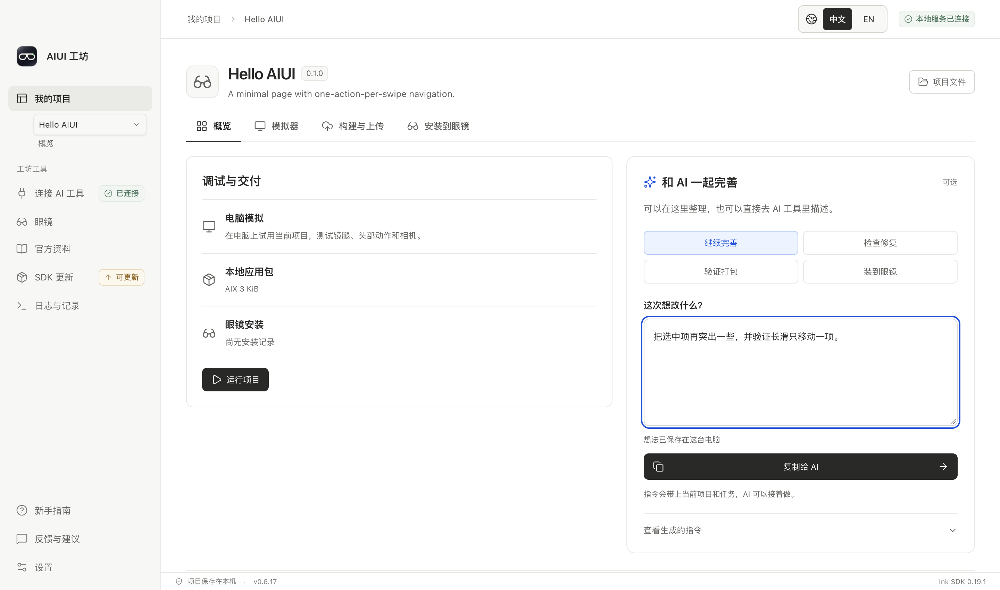
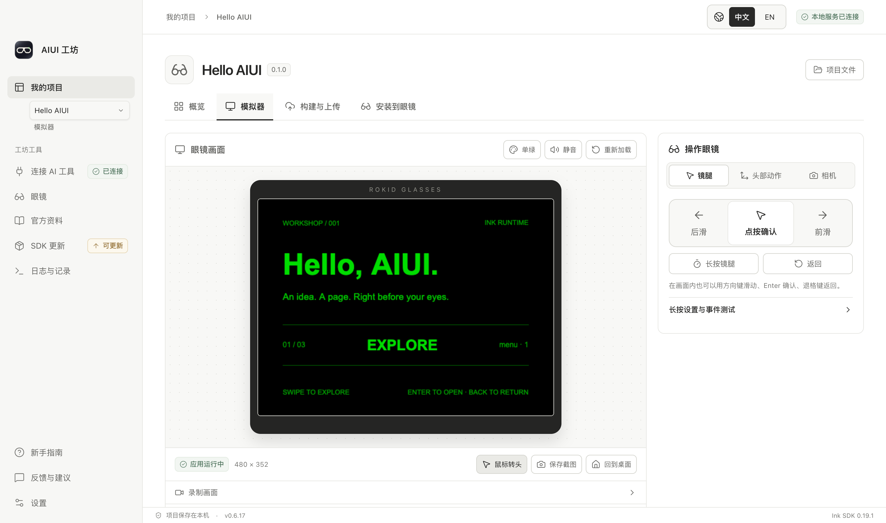

# AIUI 工坊 · AIUI Workshop

[下载最新版](https://github.com/syjstc/aiui-workbench/releases/latest) · [图文使用指南](docs/getting-started.md) · [English](README.en.md)

面向 Rokid AIUI 的本地开发工作台。从一个项目开始，用 AI 写应用，在电脑上模拟验证，再打包安装到眼镜。



## 下载与安装

在 [GitHub Releases](https://github.com/syjstc/aiui-workbench/releases/latest) 下载正式安装包和 `SHA256SUMS.txt`。国内下载可使用下表的固定链接。版本变化见 [更新记录](CHANGELOG.md)。

| 平台 | 国内下载 | 安装 |
| --- | --- | --- |
| macOS · Apple Silicon | [下载 DMG](https://cnb.cool/openwork-labs/aiui-workbench/-/releases/download/stable/AIUI-Workbench-latest-darwin-arm64.dmg) | 将 `AIUI Workshop.app` 拖入「应用程序」。正式包采用 Developer ID 签名和 Apple 公证。 |
| Windows 10 / 11 · x64 | [下载 ZIP](https://cnb.cool/openwork-labs/aiui-workbench/-/releases/download/stable/AIUI-Workbench-latest-win32-x64.zip) | 完整解压后双击 `AIUI Workshop.exe`。便携包未签名，运行前请核对下载来源和 SHA256。 |

桌面包自带 Ink、npm、AIX CLI、ADB 和 scrcpy。macOS 可在工坊内下载并重启升级，Windows 下载新版后替换便携目录。

## 快速开始

1. 在「我的项目」新建项目，或导入 [Hello AIUI 示例](examples/hello-aiui)。
2. 使用 AI 时，打开「连接 AI 工具」，复制完整连接指令并粘贴到常用的 AI 编程工具。AI 成功读取当前工坊的开发上下文后，界面会显示已连接。
3. 在项目的「模拟器」运行应用，试一下镜腿触控和头部动作，查看应用日志。
4. 在「构建与上传」检查并生成 AIX。眼镜打开调试后，回到该项目的「安装到眼镜」选择设备并安装。

## 主要功能

- **项目工作台**。概览、模拟器、构建与上传、安装到眼镜都跟随当前项目。切到其他工具再返回时，会回到原项目页签。侧栏下拉可以快速换项目或打开全部项目。
- **真实 Ink 模拟器**。运行实际 `.ink` 页面，测试镜腿点按、长按和滑动。可在彩色与单绿间切换，用电脑摄像头或本地照片取景。头部动作支持姿态调节、实时 IMU 读数、手动输入和录制数据回放。
- **AI 协作与 Skill 库**。AI 可通过 MCP 编辑项目源码、验证交互、截图、打包并接续安装任务。在「连接 AI 工具 → Skill 库」可以直接浏览工坊内置 Skill 和 Rokid 官方 Skill 的原文及参考。专题按任务需要读取。 [自动制作与故障恢复](docs/automated-development.md)
- **构建与真机安装**。工坊会检查项目与 SDK 的兼容性，展示当前 AIX 的实际体积。眼镜支持有线和无线调试，并提供应用管理、文件、日志和投屏。 [无线连接指南](docs/wireless-debugging.md)
- **云端草稿与提审**。展开项目的「上传与提审」后，工坊自动检查官方登录。按上传草稿、准备材料、核对提审三步操作。「官网应用」可只读查看云端版本，提交审核需要本人在桌面确认。 [草稿上传与提审](docs/platform-uploads.md)



「官方资料」可离线阅读和搜索官方文档。「SDK 更新」提供逐项目版本切换和兼容性检查。「反馈与建议」会先展示可核对的脱敏预览。 [资料库说明](docs/document-library.md) · [反馈指南](docs/feedback.md)

界面截图使用仓库公开示例和隔离资料拍摄。模拟器、真机安装、佩戴体验与商店审核分别验收。

## 从源码运行

建议使用 Node.js **24 LTS**，最低 **22.22**。

```sh
git clone https://github.com/syjstc/aiui-workbench.git
cd aiui-workbench
npm ci
npm run prepare:tools
npm run dev
```

`prepare:tools` 下载并校验 ADB 和 scrcpy。只使用模拟器、项目和官方资料时可跳过。也可以运行 `npm run web`，Web 工坊仅监听本机。

如需手动接入，在「连接 AI 工具」展开「手动配置与高级选项」。推荐先调用 `aiui_context_get({setup:true})`，再用 `aiui_workflow_start` 创建任务。修改项目源码后，用 `aiui_workflow_continue` 验证、打包并接续安装。 [MCP 与 CLI 工具参数](docs/ai-tool-workflows.md)

## 文档与许可

- [图文使用指南](docs/getting-started.md) · [公开示例](examples/)
- [Web 与更新源](docs/web-and-updates.md) · [解绑与删除项目](docs/project-removal.md)
- [开发与验证](docs/development.md) · [签名与发布](docs/releasing.md) · [贡献指南](CONTRIBUTING.md)

项目、任务记录和官方账号会话保存在本机。工坊是独立社区项目，源代码和示例采用 [MIT 许可](LICENSE)。官方资料、Ink 与其他依赖保留各自许可。 [第三方声明](NOTICE.md)
