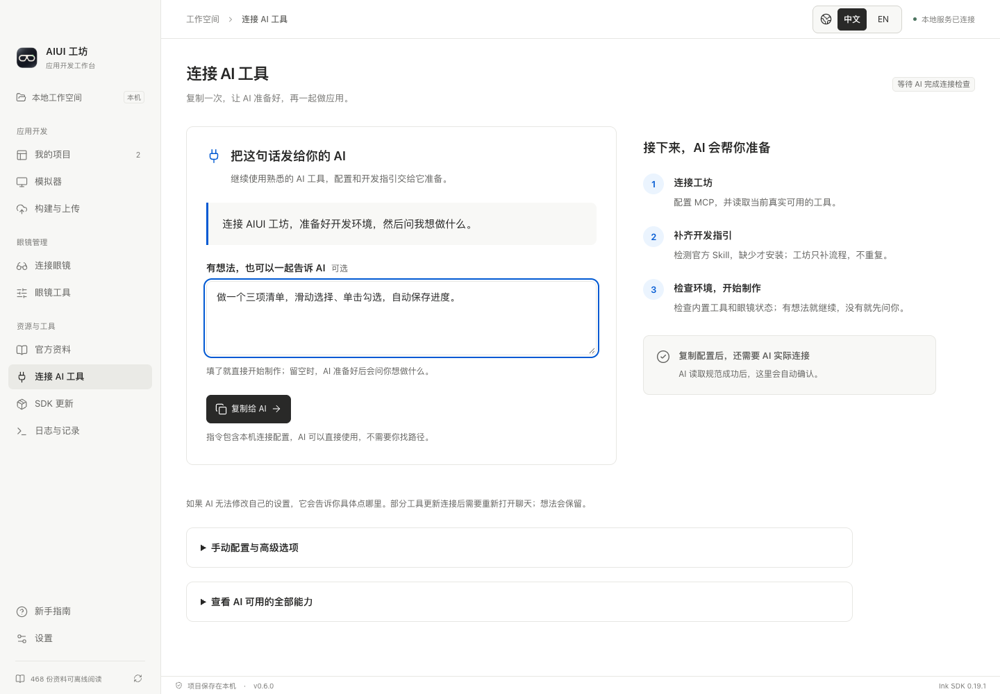
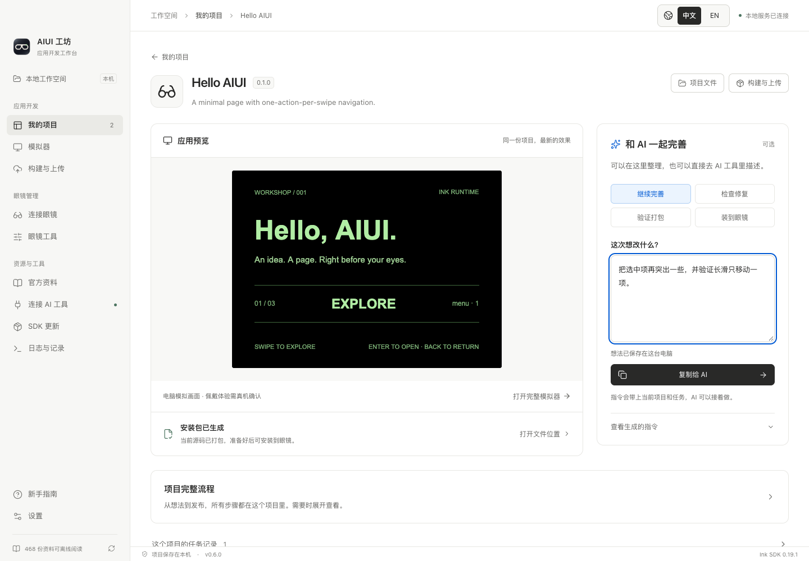
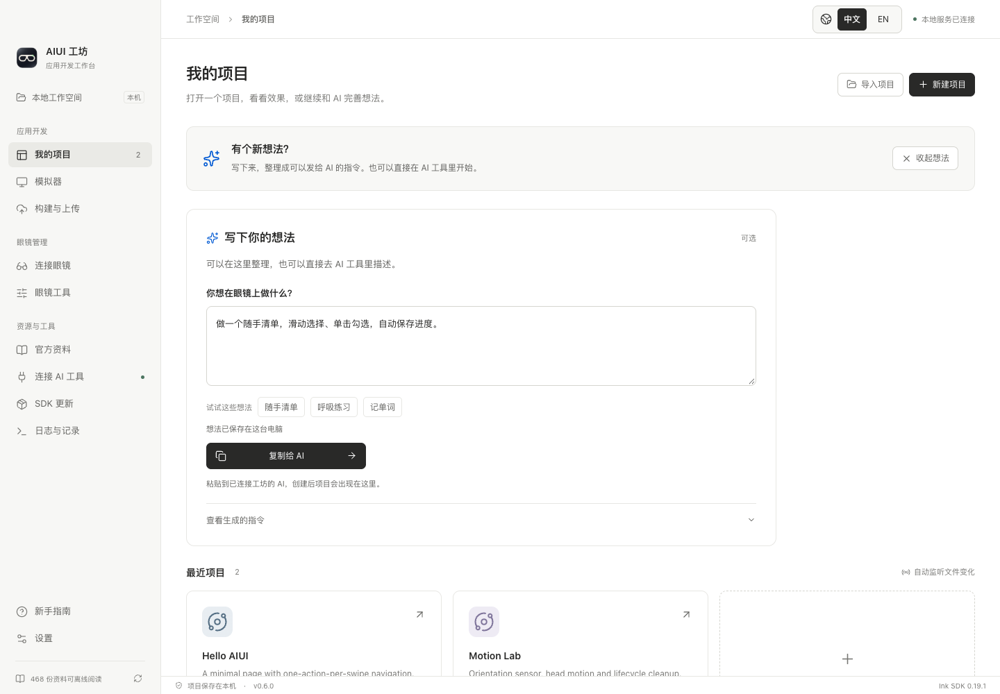

# 用一句需求制作应用

用户在已经连接工坊的 AI 编程工具里描述想法，例如：

> 使用 AIUI 工坊，做一个三项清单：滑动选择，单击勾选，保存进度。验证并打包，眼镜就绪后安装并打开。需要我操作时，告诉我步骤，然后继续。

工坊不内置生成模型。AI 使用自身生成能力，通过 MCP 源码读写或自己的编码工具修改同一份本地源码；工坊负责规范、执行、验证证据和进度。

## 首次使用：复制给 AI

首次打开空工作空间会进入“连接 AI 工具”。用户只需复制连接指令，粘贴到自己的 AI 客户端；可选填写想法。指令包含本机稳定 MCP 入口及完整配置，要求 AI 合并自己的配置、保留其他服务，并刷新连接。客户端无法自行修改设置或重载时，AI 说明具体页面和点击步骤，不要求新手使用终端。工坊不能强制所有客户端热更新工具；必要时重连或开启新聊天，保留需求继续原项目。

连接后调用 `aiui_context_get({setup:true})`，一次返回真实工坊服务版本、可用工具名称、官方规范、补充流程 Skill、Skill 安装结果和环境检查。检测到的设备问题不会阻止先制作、预览和打包。填写了想法就继续制作；没有想法时 AI 主动询问，不擅自创建示例。

界面只把 MCP 成功读取上下文（或成功开始并返回项目上下文）的调用视为本次连接已验证。复制配置、CLI、工具发现、失败调用和上一进程的历史记录都不会误报成功。Runtime / CLI 与工坊服务版本分别显示。

## 官方 Skill 与工坊补充

官方 [`aiui-dev`](https://github.com/yodaos-project/AIUI/tree/main/skills/aiui-dev) 负责应用语法、组件、接口、设计规则和交付检查；`aiui-workshop` 只补 MCP 连接、批量执行与任务恢复。官方要求的检查可由等效 MCP 工具执行，不能降低验收标准。当前没有发现需要改写官方原文的实质冲突。

首次 setup 检测用户级、当前项目及祖先项目中的 `.agents/skills`、`.codex/skills`、`.claude/skills`、`.cursor/skills`，按 Skill 声明的名称去重，也识别改过目录名的已有 Skill。缺失时安装到用户的 `.agents/skills`；项目使用 `aiui_context_get({projectId})` 时也检查并补齐缺失项目 Skill。首次指令还要求 AI 检查自己已加载的插件或云端 Skill，通过 `existingSkills` 在上下文与流程启动调用中告知，工坊跳过相应本地安装；两份指引同时通过 MCP 上下文直接提供。

官方安装保留对应知识快照的原文、references 和示例，逐文件核对 SHA256，记录源仓库与 revision。项目上下文始终返回项目绑定的官方版本。工坊管理的、未经用户修改的文件可随后续 setup 或上下文读取更新；已有外部 Skill 和用户改动保留，冲突会返回安装状态供 AI 处理，不另装同名副本。Skill 和配置从 AIX 包中排除。

服务不可用时，Skill 和首次连接指令均要求 AI 按证据区分：尚未打开工坊、需要重启、MCP 未配置或需要刷新、工坊版本过旧。AI 提供打开、重启或更新的具体下一步，保存原需求与项目标识，恢复后继续。仅超时不能据此断言需要更新。

## 工具升级

AI 配置使用稳定启动入口。打开新版工坊后发布当前安装位置；MCP 在旧服务空闲且进程核实后可切换新服务，运行中任务或旧界面会阻止自动切换并返回原因。服务替换后重新发现实际 tools/list，并发送工具变更通知；提示词和旧版本兼容路径也随真实能力变化，不把新版方法灌给旧服务。未来版本的启动注册不会被此版本降级覆盖。已有不支持这些保护的旧程序仍可能重写自己的入口，因此应关闭旧安装，使用当前安装打开工坊。

新手指南按开始使用、和 AI 开发、预览与验证、装到眼镜、发布应用、遇到问题分模块；原有完整连接步骤和高级工具继续保留。

## 推荐工具链

1. `aiui_workflow_start({request})` 自动准备目录和项目，返回 `workflow.id`、源码路径、官方规范及交互约束。已有项目传 `projectId`；可用 `requestId` 防止重试时重复创建。
2. AI 读取返回的官方 Skill、projectInstructions 与相关 references。调用 `aiui_project_files({projectId,action:"list"})` 列出文件，`action:"read",paths:["pages/index/index.ink"]` 读取源码及 revision，再用 `action:"write",expectedRevision,files:[{path,content}]` 写入真实源码。每次最多 20 个文件 / 1 MB，版本变化会拒绝覆盖；隐藏目录、工具配置、指令及符号链接受保护。也可使用 AI 自己的编码工具。菜单使用项目自带的 `lib/temple-navigation.js`，按 AGENTS.md 验证长滑、重复事件、停顿后第二滑、反向、翻页和返回。
3. `aiui_workflow_continue({workflowId, steps})` 回放显式应用行为断言，保存预览截图，通过静态检查后打包。默认目标为眼镜；只需包时传 `target: "package"` 开始任务。
4. 设备就绪时继续安装、启动，采集真机画面、设备信息和日志。安装和截图不代表佩戴手势或声音已经验收。
5. `aiui_workflow_get` 和桌面对应的项目页显示相同的阶段、证据和下一步。代码或 SDK 变化会使旧证据失效，下一次继续时重新验证。

`continue` 默认最多等待 45 秒。返回 `status: "running"` 时用原任务 ID 调用 `aiui_job_wait`，不要重复发起新任务。恢复任务时省略 steps 会保留原断言；传入新 steps 会重跑预览。源码未变化时会保留有效的打包与成功安装记录。

## 卡住后怎么继续

任务的 `result.workflow.state` 为 `waiting-user` 时，读取 `nextAction`：

- `owner: "user"`：AI 说明具体卡点、用户操作和恢复方式。例如在手机开启眼镜 ADB、在眼镜允许连接、选择多台设备中的目标，或检查网络/登录。
- `owner: "ai"`：AI 主动读取诊断、修正源码和断言，再继续；无需让用户转述技术日志。

用户完成操作后，继续同一个 workflowId。也可以在工坊点击“重新检查并继续”。不重建项目，不盲目重复安装；云端结果不明时仍走既有只读核对流程。

缺少应用行为断言时，预览和打包可以完成，但任务会交回 AI 补充验证，不会宣称功能已经验收。AI 仍需检查返回的真实截图，并向用户交代佩戴验证的边界。

模拟器未接入真实模型、语音等服务时，AI 可明确传入 `verification: {mode: "device", reason: "具体限制及真机验收计划（至少 10 字）"}`，改为检查、打包、连接眼镜、安装和真机采证。此模式只适用于眼镜目标；界面与结果会保留“模拟未验证、真机功能待确认”，不会把跳过的断言标为通过。后续调用省略 verification 会保留选择；传 `{mode: "simulator"}` 恢复模拟验证。

电脑预览为 `wx` 存储提供按项目隔离的本机持久化适配，支持同步与异步的写入、读取、删除、清空，重建运行时和重开工坊后保留。此适配只注入模拟器内存中的运行包，不修改项目文件和真机安装包；状态会标注 `storage: project-persistent-simulation`。每项目限 1 MB / 1000 项，保存失败会报告错误。电脑与眼镜的应用数据分别保存，不自动互传。

## 共享诊断

共享诊断按实际 `projectId` 隔离，自动从预览会话、后台任务、制作流程及明确的项目路径补齐项目名称、目录和任务标识，并为旧记录回填可核实的归属。公共环境标为 `scope=workbench`；缺少证据或项目标识冲突时标为 `scope=unassigned`，AI 必须先核实来源，不能猜测当前界面选中的项目。已移除项目仍保留记录时的名称和路径。

AI 通过 MCP / 共享 CLI 调用工坊工具时，响应会在 `sharedDiagnostics` 自动附带当前项目和公共环境的未读诊断；不消耗其他项目的未读问题。没有项目范围的普通调用只附带公共环境及待确认归属的问题。连接发现和桌面轮询不算 AI 阅读，也不会在没有 AI 调用时主动唤醒外部 AI。报错响应同样携带原始诊断与恢复步骤，用户无需复制。批次未读未取完时，`remainingUnread` 提示继续按相同项目范围读取。

`aiui_diagnostics_get` 支持 `projectId`、`diagnosticId`、`scope`、`read`、`status`、`afterSequence`。默认显示最近的问题，显式游标按顺序增量读取；`read=false` 只取未读，`markRead=false` 仅查看。AI 实际读取返回记录后自动持久化 `readAt/readBy`，桌面默认只显示未读，可筛选项目、已读未修复或全部未解决；手动收起使用 `aiui_diagnostics_mark_read`。只标记此次返回的记录，新发生的同类问题恢复未读。**已读不代表已修复**，`status` 仍为 `open`；验证修复后才调用 `aiui_diagnostics_resolve`，同一制作任务重新验证成功也会解决关联诊断。原始错误、调用栈、操作上下文、源码与工具链版本和恢复步骤始终保留供回查。

`aiui_service_log_read` 可读取脱敏后的服务日志正文。主服务未能启动时，MCP 会保留诊断读取与环境重试工具；服务恢复后重新发现完整工具。编码工具也可使用生成的 CLI 入口运行 `diagnose`，该命令不需要主服务启动。

## 无线连接

“连接眼镜”中保留 USB 自动检测，并增加无线地址/可选配对码。用户先开启相应的无线调试，电脑和眼镜在同一网络；需要配对时先使用配对地址和六位码，再连接调试地址。AI 可用 `aiui_adb_connect`，配对码不保存到诊断。固件能力和具体准备步骤以[官方无线指南](https://forum.rokid.com/post/detail/3585)为准。

## 仍然保留的功能

项目库、完整模拟器、录制、构建与上传、官网应用、眼镜文件和应用管理、投屏、官方资料、SDK 切换、语言与外观、任务日志和高级 MCP 配置都保留。首页为“我的项目”，打开项目后集中查看应用画面；完整流程和记录按需展开，高级能力仍可从原导航访问。

项目页提供可选的想法输入框，以及继续完善、检查修复、验证打包、安装到眼镜等预置指令。填写后立即整理为可复制给 AI 的文本，带上当前 projectId 和匹配的 workflowId，避免重复创建项目；“验证打包”限定使用预览与构建工具，不顺带触发真机安装。想法草稿保存在此电脑并按项目隔离。也可以直接在外部 AI 工具里描述，工坊继续同步同一个项目，不要求先填写表单。

“我的项目”还提供独立的“写下想法”入口，内置随手清单、呼吸练习、记单词示例。选中示例只填入想法，复制给 AI 后才开始制作。

正式提审继续要求用户在桌面确认。此流程不会自动发布，不会把电脑模拟结果标成佩戴验收。
