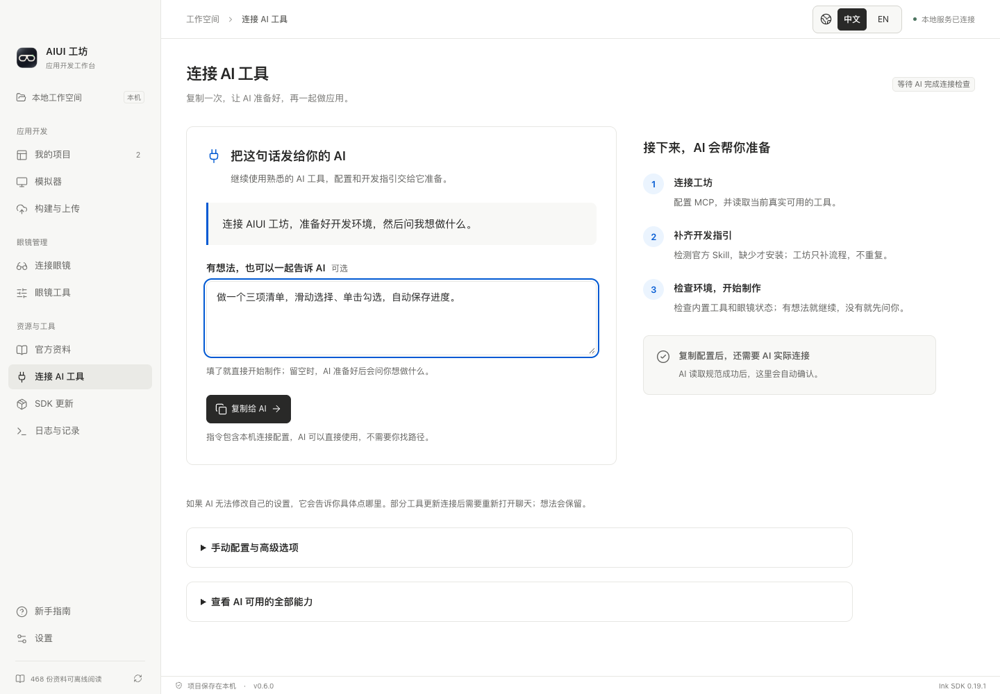
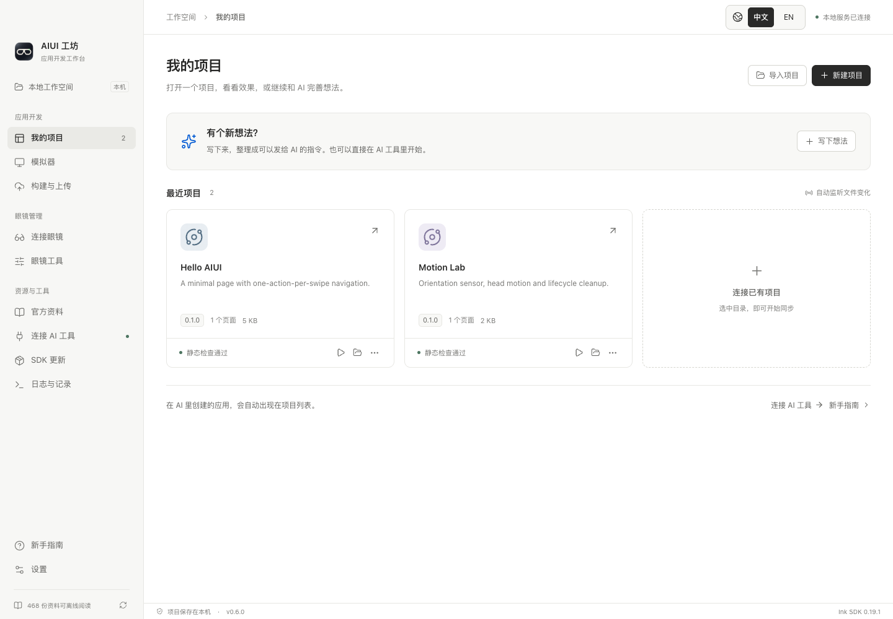
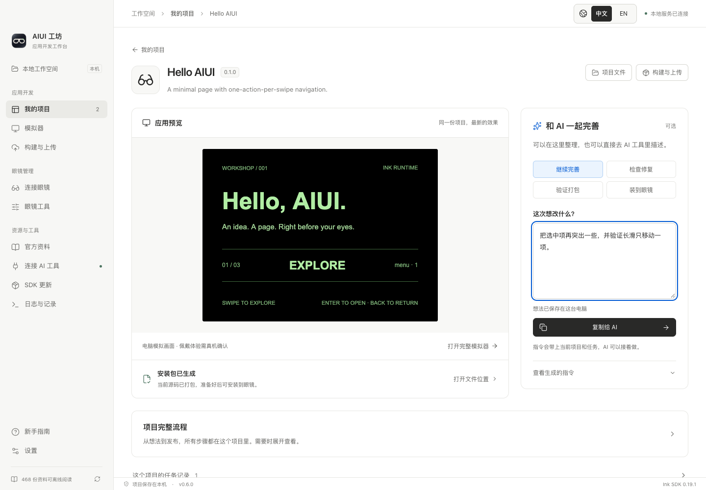
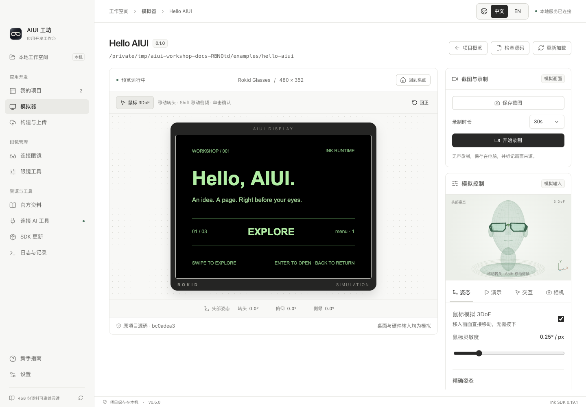
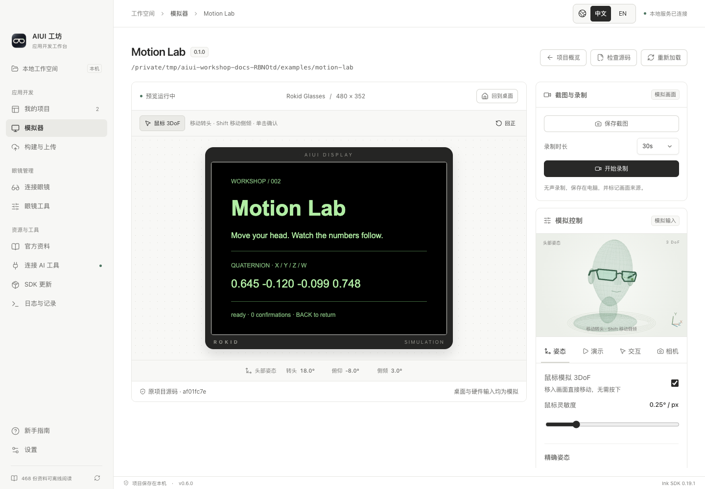
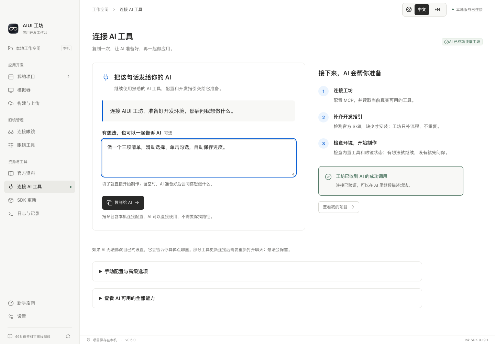
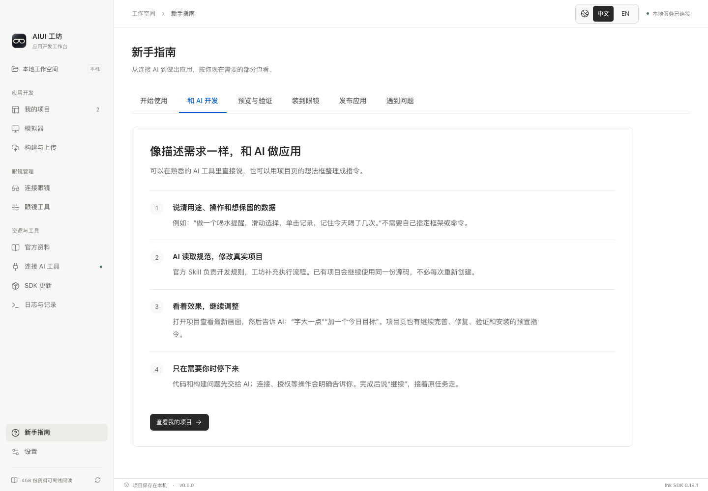
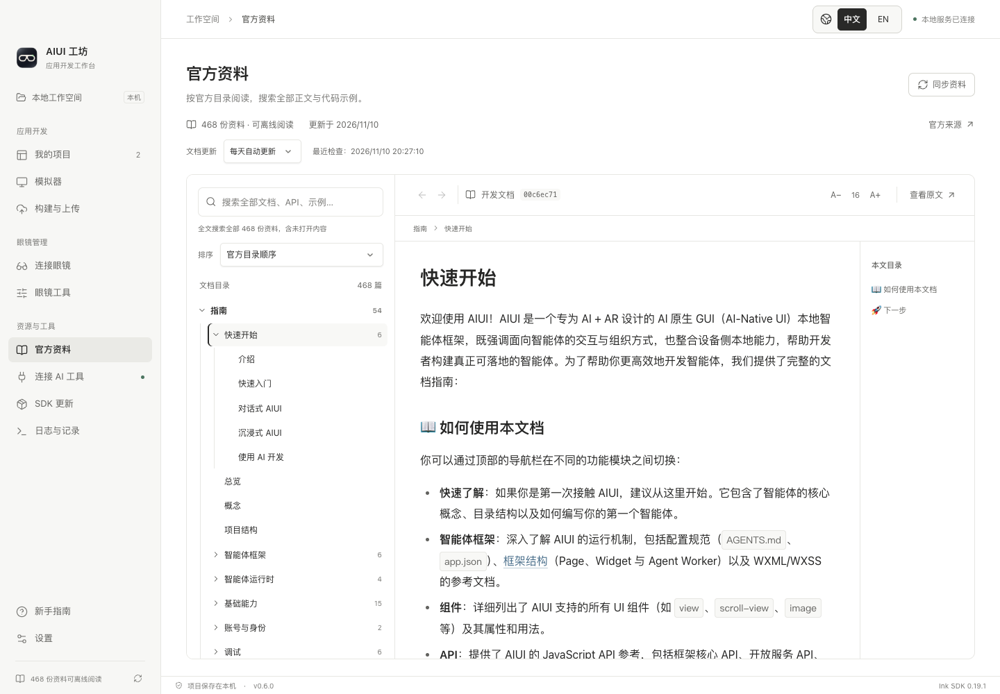

# 从想法或示例开始

本指南使用仓库里的 Hello AIUI 和 Motion Lab。截图来自电脑上的真实 Ink 运行时，输入由模拟器发送。

## 1. 安装并连接 AI

从 [GitHub Releases](https://github.com/syjstc/aiui-workbench/releases/latest) 下载与你系统匹配的安装包，并核对同页 SHA256。macOS 推荐打开 DMG，将 `AIUI Workshop.app` 拖到“应用程序”，也可使用 ZIP；Windows 完整解压 ZIP 后启动 `AIUI Workshop.exe`，保留同目录的资源与 DLL。

首次打开空工作空间会进入“连接 AI 工具”。可填写想法，点击“复制给 AI”并粘贴到你熟悉的 AI 客户端；AI 会准备 MCP、官方开发 Skill 和环境。有想法就直接开始，留空时由 AI 询问。只有 AI 成功读取当前工坊后，才显示连接已确认；复制指令本身不代表连通。

AI 制作的应用自动出现在“我的项目”。要先体验公开示例，点击“导入项目”，选择本仓库的 `examples/hello-aiui`，再导入 `examples/motion-lab`。也可以点击“新建项目”生成 Page。

项目源码仍保存在你选择的目录。用编辑器或 AI 工具修改后，工坊会监听变化并刷新预览。

## 2. 打开项目、继续完善

点击 Hello AIUI 卡片，进入独立项目页。左侧展示当前应用的真实模拟画面；右侧可填写想法，也可选择继续完善、检查修复、验证打包或装到眼镜，复制给 AI。指令带上当前项目和任务，继续使用同一份源码。想法按项目保存在本机，也可以直接在 AI 客户端描述。

“项目完整流程”和“这个项目的任务记录”按需展开。源码或 SDK 变化后，需要重新验证和打包；旧安装包会提示更新。

## 3. 运行、滑动和返回

在项目页点击“打开完整模拟器”。方向键在三个选项间切换，Enter 进入分页状态，Backspace 返回；菜单下再次返回会退出至模拟器桌面。

右侧“交互”面板可以发送普通滑动、8 条重复别名事件和约 1.5 秒的长滑。一次同方向连发应只移动一项；停顿后再次滑动移动下一项。示例使用 [离散输入模块](../examples/hello-aiui/lib/temple-navigation.js)，详情见 [输入规范](rokid-discrete-input.md)。

## 4. 调节头部姿态

运行 Motion Lab。鼠标移入画面后移动即可调节转头与俯仰，Shift + 移动调节侧倾。也可以操作头模、三轴滑条，或在“演示”面板循环播放动作。

画面中的四元数来自应用订阅的官方 `AbsoluteOrientationSensor`。隐藏和退出页面会停止订阅。关闭“模拟姿态流”可以检查断流时的行为。

## 5. 让 AI 与工坊协作

“连接 AI 工具”显示成功调用后的连接状态。需要手动设置时展开“手动配置与高级选项”；新手使用完整连接指令即可。不需要把整个项目复制进另一套环境。

可以给 AI 这样的任务：

> 使用 AIUI 工坊，做一个三项清单：滑动选择、单击勾选、保存进度。验证长滑只走一项、停顿后的第二滑、反向和返回，再打包。眼镜就绪后安装并打开，需要我操作时说明步骤，然后继续。

AI 使用自动制作流程连续验证、打包和安装；受阻时读取恢复步骤并继续原任务。预览中的 `wx` 存储按项目持久化，重开后保留进度；电脑和眼镜数据分别保存。工具细节见 [自动制作与故障恢复](automated-development.md) 和 [AI 工具工作流](ai-tool-workflows.md)。工坊本身不内置模型。

新手指南分为开始使用、和 AI 开发、预览与验证、装到眼镜、发布应用、遇到问题六个标签页，按当前任务查看。

## 6. 查资料、构建和连接眼镜

“官方资料”可离线搜索、阅读开发指南和 API；正文的官方文档链接会在工坊内打开。“查看原文”访问上游来源。

“构建与上传”有“打包与上传”和“官网应用”两个标签页，顶部显示官方接口仍为实验功能的警告。“打包与上传”按以下步骤操作：

1. **登录并统一绑定**：在桌面点击蓝色“登录官方平台”，成功后立即同步并关闭登录窗口，后续复用尚有效的系统加密会话。选择一次本地应用，在“设置官方绑定”中核对正式名称和高亮的完整官网 Agent ID，保存后构建、上传、提审共用同一目标。新应用先在官网创建身份。
2. **检查并打包**：点击“检查并打包 AIX”。检查通过后生成本地 `application.aix`；点击“定位 AIX 文件”打开所在文件夹，或复制文件路径。“构建详情”中可以核对代码指纹、引擎要求和 SHA256。代码或 SDK 变化后需要重新打包。
3. **上传为云端草稿**：点击“上传为草稿”，或让 AI 调用 `aiui_platform_upload`。工坊回读云端版本、包及代码摘要后才显示已核对。本地版本与云端版本分别保留；保存材料也可能递增云端版本。
4. **准备材料并确认提审**：AI 通过 `aiui_platform_review_prepare` 上传图标、3–5 个图片／视频素材、文案与权限用途，再用 `aiui_platform_review_request` 请求你确认。也可在表单编辑文案和预览路径。用户核对资料后点击“核对完成，确认提交审核”，并在原生窗口确认；取消不会提交。上传或保存材料本身不会提审。**确认时应确保版本与材料可公开发布，审核通过后的上架规则以官网为准，工坊不保证还有一次发布确认。**

“官网应用”仅刷新、读取官方图标、介绍、权限、图片／视频，以及草稿、审核和已上架版本。列表与 MCP 均不提供云端删除；删除须本人去官网操作。红色“退出官方账号”会清除登录凭据、撤销待确认操作并停止平台任务，本机项目和回执保留。Web、CLI、MCP 使用平台能力时需保持已登录的桌面运行。

完整材料要求、状态解释、登录和安全边界见 [草稿上传与提审](platform-uploads.md)。真实账号草稿上传已验证，真实提审和上架结果仍需分别验证；官方接口变化或结果不明时先刷新核对，不重复提交。官方要求见 [提审规范](https://github.com/yodaos-project/AIUI/blob/main/documentation/0-guide/bundle/publish.md)。

连接眼镜请按“新手指南 → 装到眼镜”执行：使用对应机型的专用数据调试线，在手机 Rokid AI App 中开启眼镜 ADB 调试，并授权电脑。也可按官方无线方案准备，再到“连接眼镜”输入无线调试地址和所需配对信息。多台设备时先选目标，再安装或启动。投屏和文件工具位于独立的“眼镜工具”页。

## 常见问题

| 情况 | 处理 |
| --- | --- |
| Windows 解压后打不开 | 确认解压了完整 ZIP，EXE 的 DLL 和 resources 均在原目录；核对来源与 SHA256，查看系统提示 |
| 没有发现眼镜 | 检查数据调试线、手机端 ADB 开关和设备授权；Windows 检查驱动；展开连接诊断 |
| 相机没有画面 | 先在模拟器“相机”页选择照片或主动选择电脑摄像头，再让应用请求取景 |
| AI 与桌面项目列表不同 | 使用当前工坊生成的配置，确认双方的 `AIUI_WORKBENCH_HOME` 一致 |
| AI 连接后看不到新工具 | 打开当前版本工坊，结束旧版活动任务并关闭旧界面，刷新 MCP；客户端仍缓存旧清单时重新打开聊天，继续同一项目 |
| 项目或任务出现问题 | 让 AI 读取当前项目诊断；工具响应会附上新问题和恢复步骤。“日志与记录”可回查已读问题，已读不代表已修复 |
| 浏览器已登录，工坊仍未登录 | 在桌面“登录官方平台”完成登录；普通浏览器自己的 Cookie 不会授权工坊 |
| 上传或提审结果待确认 | 刷新云端结果或只读回查；提审结果不明时到官网核对，不自动再次提交 |
| 升级提示旧服务仍在使用 | 结束任务并退出其他版本的工坊和旧 Web 界面，再打开当前客户端；同一数据目录只运行一个桌面版本 |
| SDK 更新后行为变化 | 先执行兼容性检查，逐项目切换；需要时回退项目绑定的版本，再做模拟和真机复测 |

模拟输入通过只能说明对应的模拟链路和断言通过。佩戴手势、相机光学、舒适度、性能和平台上架仍需各自验收。
