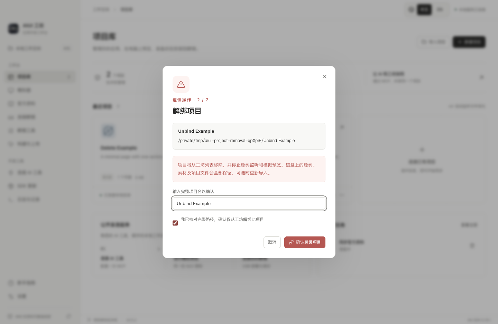
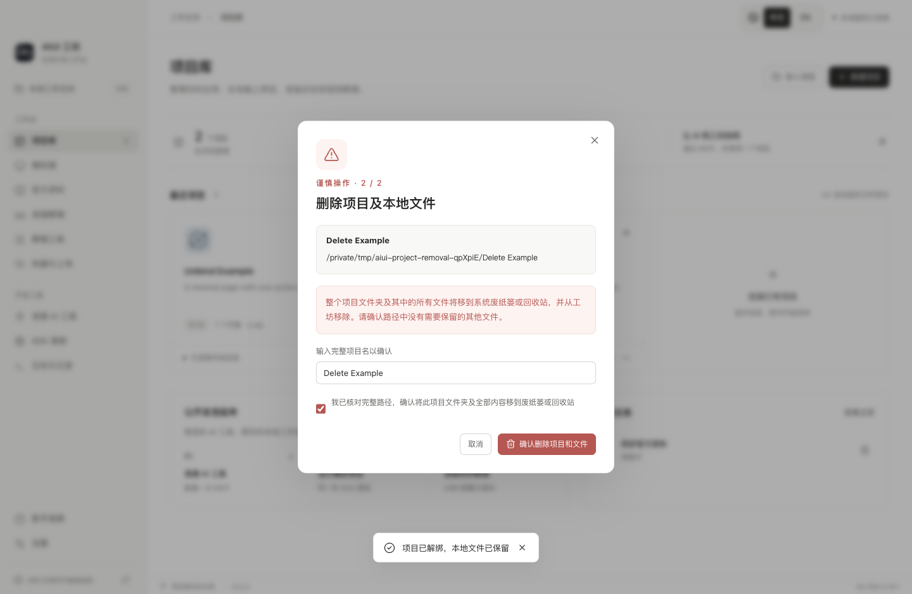

# 解绑与删除项目

项目卡片右下角的“…”菜单提供两项操作。两者都分两步确认：先查看项目名、完整路径和影响范围；再输入完整项目名、勾选确认并点击最终按钮。输入不匹配时按钮不可用，执行期间不能关闭确认窗口。

## 解绑项目

解绑会从工坊项目库移除注册项，停止源码监听并清理模拟预览。磁盘上的源码、素材和项目文件全部保留；以后可再次导入同一个目录。即使原目录已丢失，也可使用解绑清理无效注册。

## 删除项目和文件

桌面客户端使用系统废纸篓／回收站处理**确认窗口中显示的整个项目文件夹及其全部内容**，然后从工坊项目库移除。需要恢复时，请在系统废纸篓／回收站中找回目录，再导入工坊。

如果导入的是含 `agent/` 的外层工程，确认窗口显示的是外层项目目录；其中其他文件也在删除范围内，必须核对完整路径。包含工坊自身、用户目录、运行数据或其他已绑定项目的目录会被拒绝删除。

项目仍有任务、操作或录制在执行时，先完成或停止这些操作。取消、输入错误或系统移动失败均保留项目注册；系统移动成功但列表写入失败时，界面会说明情况，可再次解绑残留项。

Web 界面支持解绑。删除到系统废纸篓／回收站需在桌面客户端执行。历史构建、截图、录制和任务记录保存在工坊数据目录，可通过对应记录页单独管理。

本文截图和验收仅使用仓库中的公开示例副本，未操作个人业务项目。
